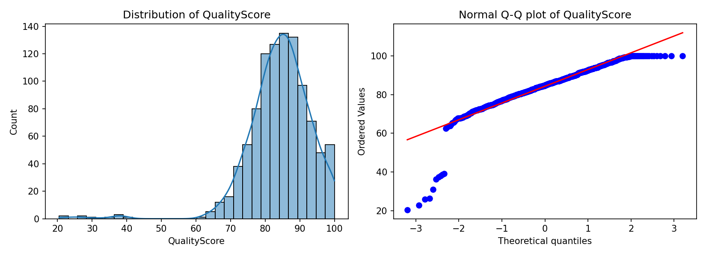
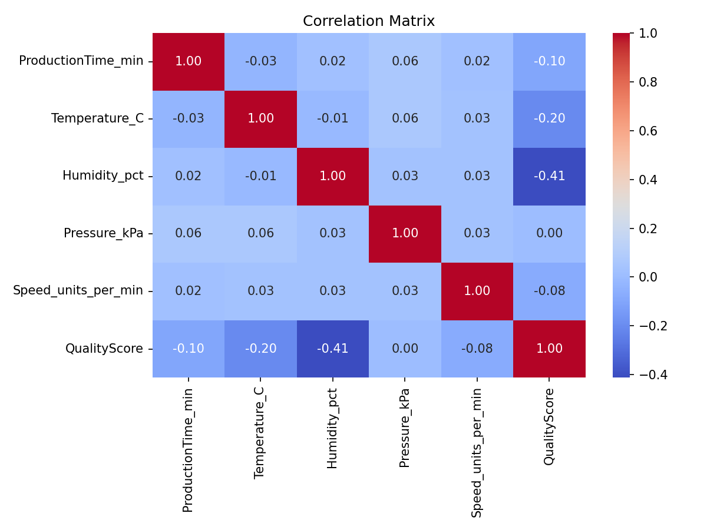
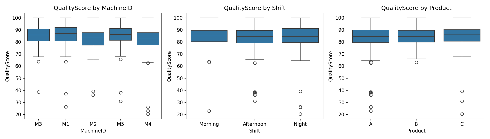
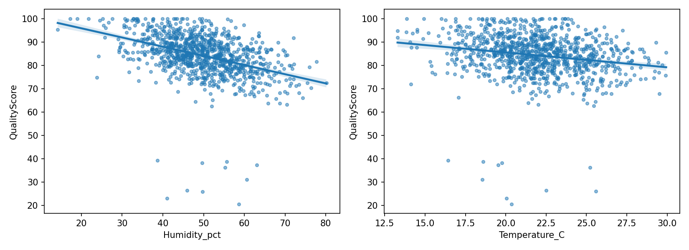
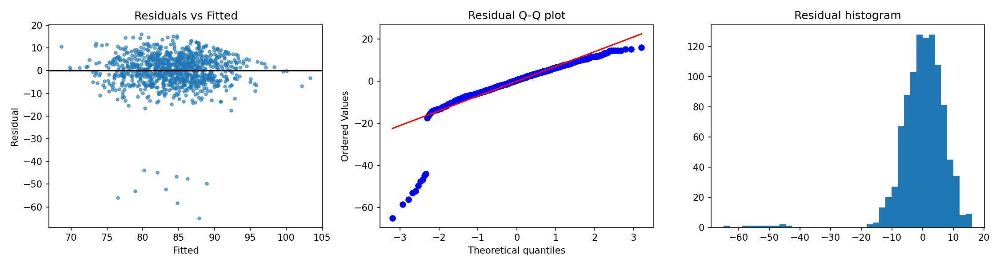
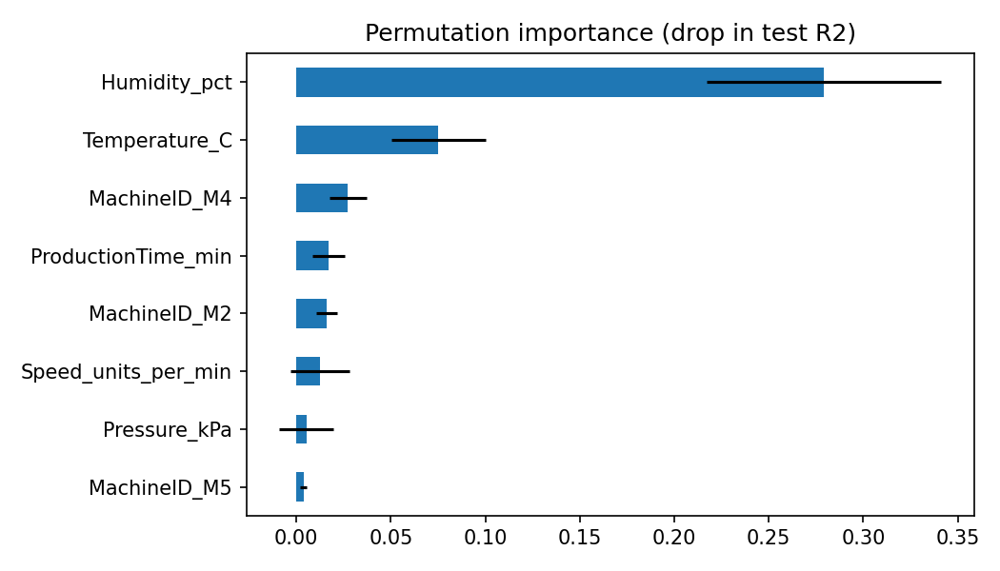

# Production Quality Analysis: Statistical Decision Making

Statistical analysis of 1,000 production records to identify the factors that influence product quality and recommend improvements.

## Objectives
1. Identify which process factors significantly influence `QualityScore`.
2. Test the factors with ANOVA, t-tests and regression, and check each method's assumptions.
3. Link the methods to linear algebra (OLS, design matrix, condition number, VIF) and calculus (marginal effects, optimum).
4. Propose evidence-based strategies for improving quality.

## Dataset
- 1,000 records, 14 fields, January to December 2024. The data is synthetic, so findings illustrate method and cannot be generalised to a real plant.
- Predictors: ProductionTime_min, Temperature_C, Humidity_pct, Pressure_kPa, Speed_units_per_min, MachineID, Shift, Product, OperatorID. Outcome: QualityScore.
- `DefectCount` and `QualityLabel` are results of production, not inputs, so they are excluded from all models.

## How to run
```bash
pip install -r requirements.txt
python production_analysis.py > results.txt
```
Full printed output is in [`results.txt`](results.txt).

## 1. Data checks
| Check | Result |
|---|---|
| Missing values | 58 rows (5.8%) lack Temperature, Humidity or Speed (20 each). Their mean score (82.8) does not differ from complete rows (84.4; Welch p = 0.33), so missing values were imputed with the median; results were re-checked with listwise deletion |
| Score distribution | Mean 84.3, sd 9.2, range 20.5 to 100. **Left-skewed** (skew -1.92, excess kurtosis 10.0): most scores are high with a tail of low scores |
| Ceiling | 22 scores equal exactly 100, so the score is capped at the top |
| Low scores | 10 scores below 60 |
| QualityLabel | All 28 "Fail" labels have scores of 62.6 to 69.6, yet scores down to 20.5 are labelled "Pass". The label is inconsistent with the score, so the continuous score is used |



## 2. Exploratory analysis
- Quality falls as humidity rises (r = -0.41) and as temperature rises (r = -0.20). Production time (-0.10) and speed (-0.08) have small effects; pressure has none (r = 0.00).
- The predictors are uncorrelated with each other (|r| <= 0.06), which is why multicollinearity is not a problem here.




## 3. Hypothesis tests

**One-way ANOVA** (Holm-corrected for four tests; Levene's test and Kruskal-Wallis used as assumption checks):

| Factor | F | p | Holm p | eta² | Conclusion |
|---|---|---|---|---|---|
| MachineID (5) | 9.67 | 1.1e-7 | <0.0001 | 0.037 | Significant |
| OperatorID (12) | 3.37 | 0.0001 | 0.0004 | 0.036 | Significant |
| Shift (3) | 0.81 | 0.447 | 0.894 | 0.002 | Not significant |
| Product (3) | 0.64 | 0.526 | 0.894 | 0.001 | Not significant |

Kruskal-Wallis agrees for all four factors. Levene's test supports equal variances except for Shift (p = 0.039), which does not change the conclusion because Kruskal-Wallis also finds no difference. Effect sizes are small: machine and operator each explain under 4% of score variance.

**Tukey HSD for machines:** M4 scores lower than M1 (-4.45, p < 0.0001), M3 (-4.10, p = 0.0001) and M5 (-3.78, p = 0.0002). M2 scores lower than M1 (-3.23, p = 0.004), M3 (-2.87, p = 0.017) and M5 (-2.56, p = 0.039). M1, M3 and M5 do not differ (p > 0.94), and neither do M2 and M4 (p = 0.66). So two machines, M2 and M4, drive the machine effect.

**Shifts (Welch t-tests):** Morning vs Night p = 0.395, Morning vs Afternoon p = 0.213, Afternoon vs Night p = 0.890. No shift effect.

## 4. Regression
`QualityScore ~ ProductionTime + Temperature + Humidity + Pressure + Speed + MachineID + Shift`, with HC3 robust standard errors.

| Predictor | Coef | p (HC3) | Effect of +1 sd |
|---|---|---|---|
| Humidity (%) | -0.404 | <0.0001 | -3.9 points |
| Temperature (°C) | -0.695 | <0.0001 | -2.1 points |
| Production time (min) | -0.147 | 0.0001 | -0.9 points |
| Speed (units/min) | -0.048 | 0.031 | -0.6 points |
| Pressure (kPa) | +0.411 | 0.219 | not significant |
| Machine M4 vs M1 | -4.45 | <0.0001 | |
| Machine M2 vs M1 | -3.91 | <0.0001 | |
| Machines M3, M5; shifts | | >0.12 | not significant |

R² = 0.277 (adjusted 0.269), F = 34.5, p < 0.0001. The measured factors explain only about 28% of the variation in quality; the rest is unexplained.

**Robustness:** Temperature and humidity stay highly significant under listwise deletion (n = 942), after removing the 22 capped scores, and after removing the 10 scores below 60 (R² rises to 0.40 without those outliers). Speed is borderline (p about 0.05) in two of the three checks, so treat it as the weakest effect.



## 5. Linear algebra
Regression is **y = Xβ + ε**, with X the design matrix (intercept, predictors and dummy variables). The estimate β̂ = (XᵀX)⁻¹Xᵀy is solved by least squares in `numpy`, and the robust (HC3) covariance uses the hat-matrix diagonal. The results reproduce an independent `statsmodels` fit.

| Quantity | Result |
|---|---|
| Condition number of raw X | 1.6e4 |
| Condition number after standardising | **2.5** |
| VIF (all five continuous predictors) | 1.00 to 1.01 |

The raw condition number looks alarming but is a scaling artefact: pressure has a mean of 101 and an sd of only 0.85, so its column is nearly proportional to the intercept column. Once the predictors are standardised, the condition number drops to 2.5 and VIFs are about 1, so there is **no multicollinearity**. Standardising the predictors fixes the numerical problem without changing any conclusion.

## 6. Assumption checks
| Test | Result | Reading |
|---|---|---|
| Shapiro-Wilk / Jarque-Bera | p = 2e-33 / JB = 16,112 | Residuals are **not normal** (skew -2.95, excess kurtosis 18.8): a heavy lower tail from a few very poor batches |
| Breusch-Pagan | p = 0.59 | No evidence of non-constant variance |
| Durbin-Watson | 2.06 | No autocorrelation |
| Cook's distance | max 0.07 | No single point dominates (21 points exceed 4/n) |

Non-normal residuals do not bias the coefficients, and with n = 1,000 the coefficient tests are approximately valid. HC3 standard errors lead to the same conclusions as classical ones. Prediction intervals, however, would be unreliable.



## 7. Is there an optimal temperature or humidity? (calculus)
Marginal effects are partial derivatives: ∂Quality/∂Temperature = -0.69 per °C and ∂Quality/∂Humidity = -0.40 per % RH. To test for an optimum I added squared terms and looked for where the derivative equals zero. Neither squared term is significant (p = 0.52 and 0.90), and the nested F-test finds no improvement (p = 0.84). The implied stationary points (-6.6 °C and -962% RH) lie far outside the observed ranges (13 to 30 °C and 14 to 80%), so they are meaningless.

**Conclusion:** within the range observed, quality falls steadily as temperature and humidity rise, and there is no interior "sweet spot". Lower is better, down to the edge of the data.

## 8. Random forest
| Model | Test R² | RMSE |
|---|---|---|
| Linear regression | 0.253 | 9.49 |
| Random forest | 0.206 | 9.78 |

The forest does not beat the linear model, which supports the idea that the relationships are essentially linear. Permutation importance (drop in test R²): Humidity 0.279, Temperature 0.075, Machine M4 0.027, Production time 0.017, Machine M2 0.016, Speed 0.013, Pressure 0.005. Impurity-based importance would wrongly rank Speed (0.16) and Pressure (0.12) highly, because it favours continuous variables.



## 9. Insights and recommendations
1. **Humidity is the biggest lever.** Reducing humidity by 10 percentage points is associated with about +4 quality points. *Recommendation:* install humidity control (dehumidification) with alarms, and prioritise it over every other action.
2. **Temperature matters too.** Each extra °C is associated with about -0.7 points. *Recommendation:* tighten temperature control; run a trial at the cooler end of the current range before setting a new target.
3. **Machines M4 and M2 produce lower quality.** M4 is about 4.5 points below M1, equivalent to roughly 11% extra humidity. *Recommendation:* inspect and recalibrate M4 and M2 first, then standardise their settings to match M1, M3 and M5.
4. **Operators differ.** Operator effects are as large as machine effects. *Recommendation:* review training and procedures for the lowest-scoring operators and share practice from the highest.
5. **No action needed on shift or product.** Neither differs significantly, so extra shift training is not supported.
6. **Production time and speed are minor levers.** Each extra minute of production time costs about 0.15 points; speed is borderline. *Recommendation:* review cycle time only after the actions above.
7. **Pressure has no measurable effect,** so monitoring it is low priority.
8. **Monitor and validate.** Track humidity, temperature and machine quality on a dashboard, and run controlled before-and-after trials, since this analysis shows association and not causation.

## Limitations
- The data is observational and synthetic, so effects are associations and not proven causes.
- The model explains only about 28% of variance; important quality drivers are not in the data.
- Scores are capped at 100 and residuals are non-normal, so prediction intervals would be unreliable.
- The `QualityLabel` field is inconsistent with the score and was not used.
- Effects are estimated only within the observed ranges (13 to 30 °C, 14 to 80% humidity).

## References
- [Author] ([year]) *[Dataset title]*. Kaggle. Available at: [URL] (Accessed: [date]).
- Pedregosa, F. et al. (2011) 'Scikit-learn: machine learning in Python', *Journal of Machine Learning Research*, 12, pp. 2825-2830.
- Virtanen, P. et al. (2020) 'SciPy 1.0: fundamental algorithms for scientific computing in Python', *Nature Methods*, 17, pp. 261-272.
- Harris, C.R. et al. (2020) 'Array programming with NumPy', *Nature*, 585, pp. 357-362.
- McKinney, W. (2010) 'Data structures for statistical computing in Python', *Proceedings of the 9th Python in Science Conference*, pp. 56-61.
